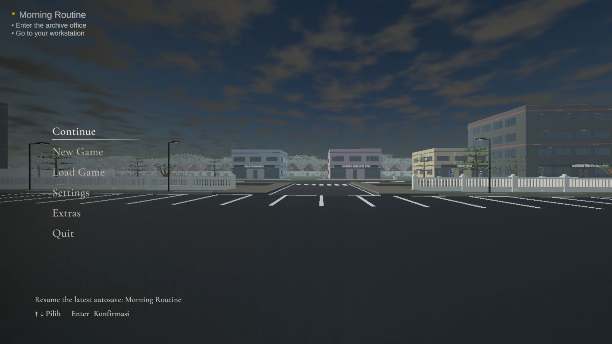
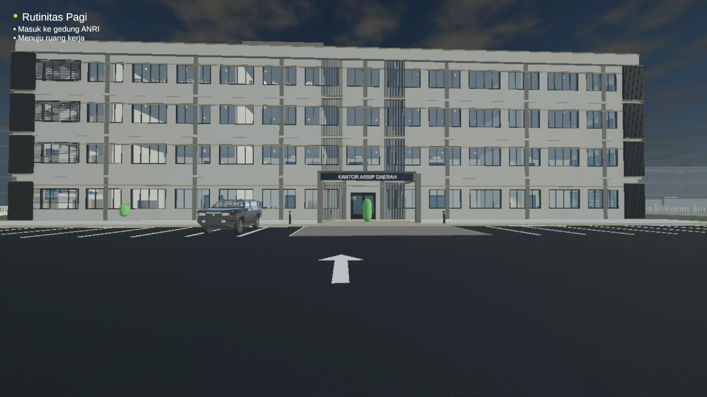
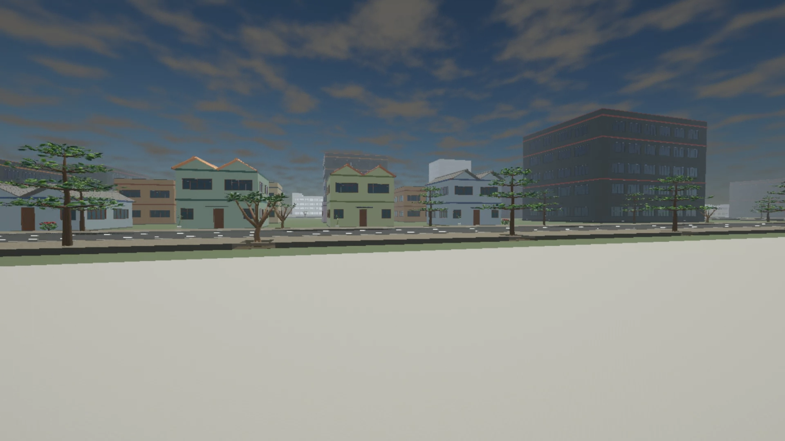
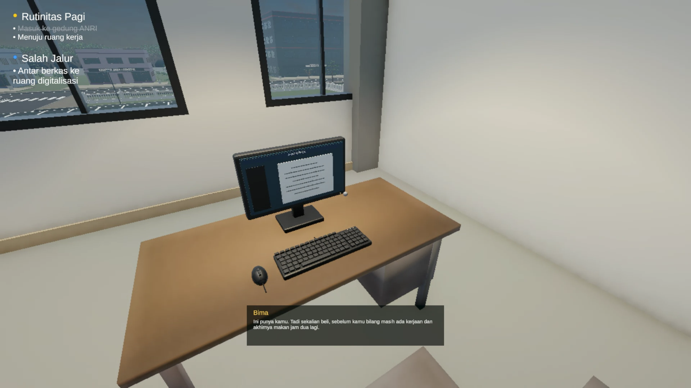
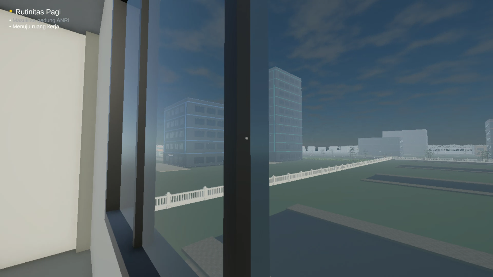
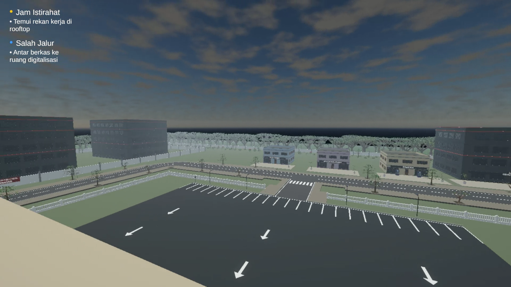
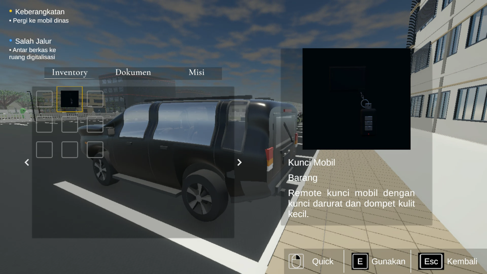
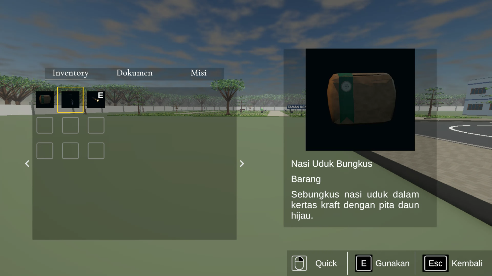
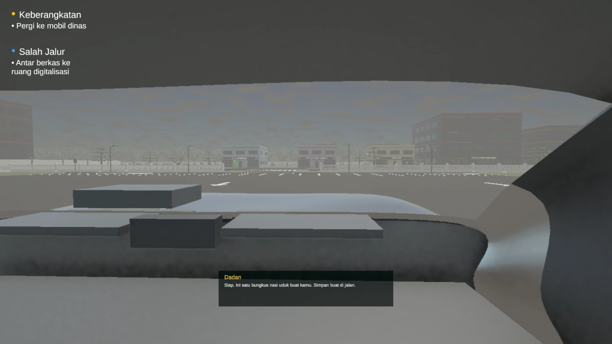
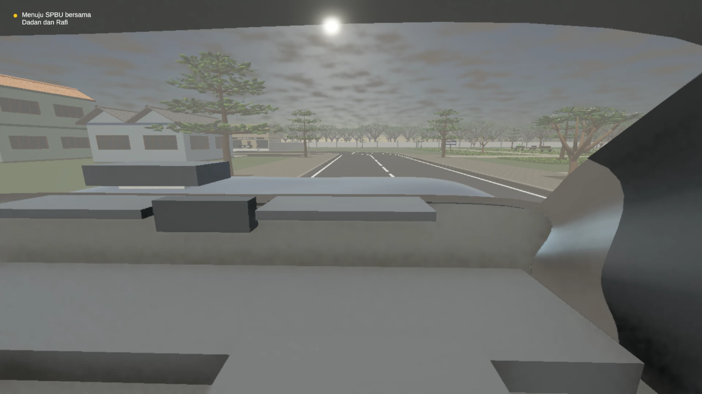

# Saksi Terakhir

**Bahasa Indonesia** · [English — The Last Witness](README_EN.md)

-000000?logo=unity)

Game horor psikologis dan misteri 3D bersudut pandang orang pertama (*first-person*) yang berlatar di Indonesia. Seorang pegawai arsip daerah bersama dua rekannya menelusuri sebuah desa terpencil yang ditemukan dalam arsip tua. Pemain mengeksplorasi lingkungan kerja dan kawasan sekitar, mengikuti percakapan kontekstual, memeriksa dokumen beraksara asli beserta terjemahannya, serta mengambil keputusan yang dicatat secara persisten sebagai kondisi cerita.

Repositori ini memuat proyek Unity, kode sumber runtime dan Editor, aset 3D modular, definisi cerita, pengujian otomatis, serta sumber Blender (`.blend`). Dokumentasi ini menjelaskan arsitektur dan implementasi sistem yang tersedia saat ini tanpa mengungkap inti misteri cerita.

---

## Daftar Isi

- [Cuplikan Visual](#cuplikan-visual)
- [Ringkasan Fitur Utama](#ringkasan-fitur-utama)
- [Status Pengembangan](#status-pengembangan)
- [Teknologi](#teknologi)
- [Membuka Proyek](#membuka-proyek)
- [Kontrol](#kontrol)
- [Sistem Gameplay](#sistem-gameplay)
  - [Pemain, Kamera, dan Interaksi](#pemain-kamera-dan-interaksi)
  - [Inventaris, Pembaca Dokumen, dan Barang di Tangan](#inventaris-pembaca-dokumen-dan-barang-di-tangan)
  - [Quest, Percabangan Cerita, dan Dialog](#quest-percabangan-cerita-dan-dialog)
  - [NPC dan Populasi Dunia](#npc-dan-populasi-dunia)
  - [Pintu, Lift 5 Lantai, dan Kendaraan](#pintu-lift-5-lantai-dan-kendaraan)
  - [Audio, Pengaturan, Waktu, dan Lokalisasi](#audio-pengaturan-waktu-dan-lokalisasi)
- [Simpan, Muat, dan Menu Utama](#simpan-muat-dan-menu-utama)
- [Struktur Proyek dan Scene](#struktur-proyek-dan-scene)
- [Alat Editor](#alat-editor)
- [Pengujian dan Pedoman Perubahan](#pengujian-dan-pedoman-perubahan)
- [Kebersihan Repositori dan Dokumentasi](#kebersihan-repositori-dan-dokumentasi)
- [Lisensi](#lisensi)

---

## Cuplikan Visual

Seluruh tangkapan layar diambil langsung dari scene aktif [Regional Archive Office](Assets/_Project/Scenes/Regional%20Archive%20Office.unity) pada resolusi 1080p dan disimpan di [docs/screenshots](docs/screenshots).

### Kawasan Kantor Arsip & Lingkungan Kota

| Fasad Depan Kantor Arsip Daerah | Suasana Kawasan Perkotaan |
| :---: | :---: |
|  |  |
| *Gedung Kantor Arsip Daerah empat lantai dengan area parkir, kendaraan dinas, dan pelacak quest aktif.* | *Jaringan jalan loop, trotoar, pertokoan, dan bangunan pendukung di sekitar kompleks arsip.* |

### Eksplorasi Interior & Rooftop

| Ruang Kerja & Interaksi Rekan | Pemandangan dari Jendela Koridor |
| :---: | :---: |
|  |  |
| *Meja kerja pegawai dengan dialog kontekstual serta pelacak quest utama (kuning) dan opsional (biru).* | *Sudut pandang orang pertama dari dalam gedung menghadap halaman dan kawasan luar.* |

| Area Rooftop Saat Jam Istirahat | Menu Utama dengan Pratinjau Dunia Langsung |
| :---: | :---: |
|  |  |
| *Teras atap gedung kantor arsip yang menjadi lokasi pertemuan awal Bab 1.* | *Menu utama terintegrasi langsung dengan kamera dunia dan status autosave terakhir.* |

### Inventaris 3D & Pemeriksaan Barang

| Kunci Mobil Dinas di Inventaris | Nasi Uduk Bungkus & Indikator Pegang |
| :---: | :---: |
|  |  |
| *Panel inventaris 3×3 dengan tab **Inventory**, **Dokumen**, dan **Misi** beserta pratinjau objek.* | *Detail barang fisik dengan penanda slot barang yang sedang dipegang (`E`).* |

### Keberangkatan & Perjalanan Kendaraan

| Dialog di Dalam Mobil Dinas | Perjalanan Otomatis Menuju SPBU |
| :---: | :---: |
|  |  |
| *Percakapan cabang cerita di dalam kabin kendaraan sebelum keberangkatan.* | *Perjalanan otomatis menyusuri rute kawasan dengan kebebasan melihat ke sekeliling dari kursi penumpang.* |

---

## Ringkasan Fitur Utama

- **Narasi Bercabang Berbasis Kondisi:** Setiap pilihan pemain (sarapan, rute salah jalur, makan siang bersama, penulisan agenda, pembelian perlengkapan, hingga interaksi di SPBU) direkam secara deterministik di [ChapterOneStoryState](Assets/_Project/Scripts/Runtime/Story/ChapterOneStoryState.cs) dan menentukan jalannya dialog, pengemudi kendaraan, serta barang bawaan.
- **Inventaris Grid, Pembaca Dokumen Dwibahasa & Perlindungan Barang Quest:** Mendukung drag-and-drop, konteks aksi, pemegangan maksimal 2 barang sekaligus, pembaca dokumen dengan tombol alih aksara asli/terjemahan, serta bingkai berdenyut untuk barang yang dilindungi quest aktif.
- **Populasi NPC Dinamis & Prioritas Berpapasan:** Pengelolaan hingga 15 NPC tampil secara bersamaan dengan pooling, rutinitas kerja (duduk, mengetik, menyapu, membawa berkas, berpatroli), sapaan kontekstual, dan sistem mengalah saat berpapasan di koridor/pintu.
- **Lingkungan Interaktif & Kendaraan Otomatis:** Pintu otomatis berbasis sensor jalur, lift kantor 5 pemberhentian (Lantai 1–4 dan Rooftop) dengan pintu geser otomatis, serta perjalanan kendaraan otomatis ke SPBU.
- **Penyimpanan Terenkripsi & Tahan Korupsi:** Autosave menggunakan JSON yang dienkripsi dengan **AES-256-CBC** dan diverifikasi dengan **HMAC-SHA256**, dilengkapi penulisan atomik dan pemulihan cadangan `.bak`.

---

## Status Pengembangan

Proyek masih dalam tahap pengembangan aktif. Sistem **Bab 1** saat ini mencakup rutinitas pagi dan kegiatan di kantor arsip, pencarian rekan kerja, rapat pengarahan pimpinan, persiapan keberangkatan, perjalanan mobil otomatis menuju SPBU, eksplorasi serta interaksi di SPBU, hingga penutup bab dengan layar hitam (*fade-to-black*).

- Di **Unity Editor**, penutup Bab 1 menghentikan Play Mode setelah progres berhasil disimpan.
- Dalam **build pemain**, penutup membekukan gameplay pada layar hitam; transisi langsung ke Bab 2 (scene desa) belum disambungkan.

Scene utama adalah [Regional Archive Office](Assets/_Project/Scenes/Regional%20Archive%20Office.unity), satu-satunya scene yang saat ini diaktifkan dalam [konfigurasi build](ProjectSettings/EditorBuildSettings.asset). Scene desa ([Regional Vilage](Assets/_Project/Scenes/Regional%20Vilage.unity)) dan scene perakitan aset di [TMP Scene](Assets/_Project/Scenes/TMP%20Scene) juga tersedia untuk pengembangan lanjutan.

> [!NOTE]
> Versi paket, struktur berkas, dan referensi dokumentasi ini telah diperiksa terhadap kondisi proyek pada **23 November 2026**. Keberadaan model, prefab, atau kode di repositori tidak otomatis menandakan seluruh alur permainan sudah selesai atau telah diuji pada seluruh target perangkat keras.

---

## Teknologi

| Komponen | Versi / Penggunaan |
| --- | --- |
| **Unity Editor** | **6000.3.24f1 — Unity 6.3 LTS** ([ProjectVersion.txt](ProjectSettings/ProjectVersion.txt)) |
| **Universal Render Pipeline (URP)** | **17.3.0** |
| **Input System** | **1.19.0** |
| **AI Navigation** | **2.0.11** |
| **uGUI & TextMeshPro** | **2.0.0** |
| **Timeline** | **1.8.11** |
| **Unity Test Framework** | **1.6.0** (EditMode & PlayMode tests) |
| **Unity Recorder** | **5.1.8** |
| **Bahasa Pemrograman** | C# dengan pemisahan assembly Runtime, Editor, dan Tests |
| **Lokalisasi** | Tabel lokalisasi kustom Bahasa Indonesia & Bahasa Inggris |
| **Penyimpanan Data** | Snapshot JSON terenkripsi (`AES-256-CBC` + `HMAC-SHA256`) |
| **Pembuatan Aset** | Blender (`.blend`), model FBX, material URP, tekstur, dan prefab modular |

Daftar lengkap dependensi tercatat di [Packages/manifest.json](Packages/manifest.json) dan [Packages/packages-lock.json](Packages/packages-lock.json).

---

## Membuka Proyek

1. Pasang **Unity Hub** dan Unity Editor versi **6000.3.24f1**. Tambahkan modul build sesuai platform target bila diperlukan.
2. Tambahkan folder repositori ini ke Unity Hub, lalu buka proyek.
3. Tunggu proses pemulihan paket, impor aset, dan kompilasi skrip selesai (`Library/` akan dibuat ulang secara otomatis pada pembukaan pertama).
4. Buka scene utama [Assets/_Project/Scenes/Regional Archive Office.unity](Assets/_Project/Scenes/Regional%20Archive%20Office.unity).
5. Tekan tombol **Play**. Pilih **Permainan Baru** (*New Game*) untuk memulai dari awal, atau **Lanjutkan** (*Continue*) bila sudah terdapat autosave yang valid.

Scene dan aset sudah tersimpan lengkap di repositori; Anda tidak perlu menjalankan ulang alat pembuat scene di menu Editor hanya untuk mencoba permainan.

---

## Kontrol

Skema input didefinisikan di [InputSystem_Actions.inputactions](Assets/InputSystem_Actions.inputactions) dan diproses oleh [PlayerInputReader](Assets/_Project/Scripts/Runtime/Player/PlayerInputReader.cs).

| Tindakan | Keyboard & Mouse | Gamepad |
| --- | --- | --- |
| **Bergerak** | `W` `A` `S` `D` atau Tombol Panah | Stick Kiri |
| **Melihat** | Gerakan Mouse | Stick Kanan |
| **Berlari (Sprint)** | `Left Shift` (Tahan atau Toggle di Pengaturan) | Tekan Stick Kiri (`L3`) |
| **Merunduk (Crouch)** | `C` | Tombol `B` / Lingkaran |
| **Melompat** | `Space` | Tombol `A` / Silang |
| **Berinteraksi** | `E` | Tombol `Y` / Segitiga |
| **Buka / Tutup Inventaris & Jurnal** | `Tab` | `Select` / `View` |
| **Tutup Panel / Permintaan Pause** | `Escape` | `Start` / `Menu` |
| **Pilih Barang / Misi** | Klik Kiri | — |
| **Menu Konteks Barang** | Klik Kanan | — |
| **Pindahkan / Buang Barang** | Drag and Drop | — |

- Header panel inventaris memiliki tiga halaman: **Inventory**, **Dokumen**, dan **Misi** (dapat berpindah dengan klik mouse atau tombol panah).
- Dialog cerita berjalan maju secara otomatis sesuai durasi teks dan kecepatan baca yang diatur pemain.
- Saat menerima panggilan telepon, pemain tetap dapat bergerak dan melihat sekeliling, sementara akses inventaris dan pause dikunci sementara.
- Selama berada di dalam mobil yang melaju otomatis, pemain bebas menggerakkan kamera untuk melihat keluar maupun ke arah rekan.

---

## Sistem Gameplay

### Pemain, Kamera, dan Interaksi

- **[PlayerController](Assets/_Project/Scripts/Runtime/Player/PlayerController.cs):** Mengelola jalan, lari, merunduk dengan pemeriksaan langit-langit, lompatan, gravitasi, serta penguncian gerak saat UI, dialog, atau adegan sinematik berlangsung.
- **[PlayerCameraController](Assets/_Project/Scripts/Runtime/Player/PlayerCameraController.cs):** Mengatur rotasi pandangan vertikal/horizontal, sensitivitas, FOV, batas tengok saat duduk, fokus pembicara dialog, serta ayunan kamera lembut pada pratinjau menu utama.
- **[PlayerInteractor](Assets/_Project/Scripts/Runtime/Interaction/PlayerInteractor.cs) & [InteractionPromptView](Assets/_Project/Scripts/Runtime/Interaction/InteractionPromptView.cs):** Melakukan raycast berjarak interaksi terhadap layer `Interactable` dan menampilkan prompt kontekstual beserta subtitle dialog ambient NPC.
- **[StoryPlayerCinematicMover](Assets/_Project/Scripts/Runtime/Story/StoryPlayerCinematicMover.cs) & [NpcConversationPreparation](Assets/_Project/Scripts/Runtime/Npc/NpcConversationPreparation.cs):** Mengatur penyesuaian jarak otomatis (~2 meter) dan validasi pijakan/halangan sebelum percakapan dimulai.

### Inventaris, Pembaca Dokumen, dan Barang di Tangan

| Fitur | Implementasi |
| --- | --- |
| **Grid Barang** | Default **3 × 3**; mendukung konfigurasi **1–8 kolom** dan **1–8 baris** (hingga **64 slot**). |
| **Daftar Dokumen** | Terpisah dari grid barang fisik, tidak memakan slot, dan dilengkapi [InventoryDocumentView](Assets/_Project/Scripts/Runtime/Inventory/InventoryDocumentView.cs) untuk membaca teks asli maupun terjemahan bahasa aktif. |
| **Drag & Drop** | Barang dapat dipindah atau ditukar antar-slot; menarik barang ke luar panel akan menjatuhkan objek 3D ke dunia ([InventoryWorldItemFactory](Assets/_Project/Scripts/Runtime/Inventory/InventoryWorldItemFactory.cs)). |
| **Ambil Kembali** | Barang yang dijatuhkan menjadi objek 3D dengan collider dan `Rigidbody`, serta mempertahankan `InstanceId` saat diambil kembali ([ItemPickupInteractable](Assets/_Project/Scripts/Runtime/Inventory/ItemPickupInteractable.cs)). |
| **Pegang Barang** | Maksimal **2 barang** dapat dipegang sekaligus; memegang barang ketiga menggantikan barang yang paling lama dipegang ([InventoryHeldItemView](Assets/_Project/Scripts/Runtime/Inventory/InventoryHeldItemView.cs)). |
| **Perlindungan Barang Quest** | [InventoryQuestProtection](Assets/_Project/Scripts/Runtime/Inventory/InventoryQuestProtection.cs) dan [InventoryQuestFrame](Assets/_Project/Scripts/Runtime/Inventory/InventoryQuestFrame.cs) menampilkan bingkai warna kategori quest dan mencegah pembuangan barang esensial selama masih dibutuhkan misi. |

Definisi barang menggunakan ScriptableObject [ItemDefinition](Assets/_Project/Scripts/Runtime/Inventory/ItemDefinition.cs) yang terdaftar pada [ItemDefinitionCatalog](Assets/_Project/Resources/ItemDefinitionCatalog.asset). Barang 3D yang tersedia meliputi kunci/remote mobil dinas, senter, baterai Li-ion 18650, power bank, tali tambang 10m, tali nilon 10m, nasi uduk bungkus, kotak P3K, dan buku agenda.

### Quest, Percabangan Cerita, dan Dialog

- **[ChapterOneDirector](Assets/_Project/Scripts/Runtime/Story/ChapterOneDirector.cs) & [ChapterOneProgress](Assets/_Project/Scripts/Runtime/Story/ChapterOneProgress.cs):** Mengoordinasikan alur Bab 1 dari rutinitas pagi, pertemuan rooftop, panggilan pimpinan, pencarian dua rekan, pengarahan akhir, pengambilan kunci mobil, hingga keberangkatan.
- **[ChapterOneStoryState](Assets/_Project/Scripts/Runtime/Story/ChapterOneStoryState.cs) & [ChapterOneConditionEvaluator](Assets/_Project/Scripts/Runtime/Story/ChapterOneConditionEvaluator.cs):** Mengevaluasi kondisi cerita untuk menentukan dialog mana yang memenuhi syarat serta siapa yang mengemudikan kendaraan saat berangkat.
- **[QuestJournalController](Assets/_Project/Scripts/Runtime/Story/QuestJournalController.cs) & [QuestTrackerView](Assets/_Project/Scripts/Runtime/Story/QuestTrackerView.cs):** Mendukung kategori **Main** (kuning), **Side** (hijau), dan **Optional** (biru), di mana pemain dapat menyematkan satu quest pendukung di bawah quest utama pada HUD.
- **[StoryNotificationView](Assets/_Project/Scripts/Runtime/Story/StoryNotificationView.cs):** Menampilkan antrean notifikasi cerita secara berurutan dan indikator autosave berkedip setelah notifikasi checkpoint selesai.

### NPC dan Populasi Dunia

- **[NpcPopulationManager](Assets/_Project/Scripts/Runtime/Npc/NpcPopulationManager.cs) & [OfficeNpcDirector](Assets/_Project/Scripts/Runtime/Npc/OfficeNpcDirector.cs):** Mengatur siklus hidup, object pooling, dan visibilitas renderer hingga batas **15 NPC tampil** di sekitar pemain tanpa menghapus peserta misi penting ([NpcPopulationMember](Assets/_Project/Scripts/Runtime/Npc/NpcPopulationMember.cs)).
- **[OfficeNpcAgent](Assets/_Project/Scripts/Runtime/Npc/OfficeNpcAgent.cs) & [NpcWorkRoutine](Assets/_Project/Scripts/Runtime/Npc/NpcWorkRoutine.cs):** Menggerakkan NPC antar-[NpcActivityPoint](Assets/_Project/Scripts/Runtime/Npc/NpcActivityPoint.cs) dan menjalankan aktivitas kerja atau percakapan ambient ([NpcContextDialogueLibrary](Assets/_Project/Scripts/Runtime/Npc/NpcContextDialogueLibrary.cs)).
- **[NpcPassageYield](Assets/_Project/Scripts/Runtime/Npc/NpcPassageYield.cs) & [NpcTrafficDecision](Assets/_Project/Scripts/Runtime/Npc/NpcTrafficDecision.cs):** Mengatur hak jalan saat dua NPC berpapasan berdasarkan prioritas `0–10` agar tidak saling macet di koridor atau ambang pintu.

### Pintu, Lift 5 Lantai, dan Kendaraan

- **[DoorInteractable](Assets/_Project/Scripts/Runtime/Interaction/DoorInteractable.cs) & [ItemKeyLock](Assets/_Project/Scripts/Runtime/Inventory/ItemKeyLock.cs):** Mendukung pintu ayun, geser, dan *roll-up*, penguncian berbasis barang, serta penutupan otomatis yang tertunda bila jalur masih ditempati.
- **[OfficeElevator](Assets/_Project/Scripts/Runtime/Environment/OfficeElevator.cs) & [ElevatorButton](Assets/_Project/Scripts/Runtime/Environment/ElevatorButton.cs):** Mengoperasikan lift gedung kantor arsip 5 lantai (Lantai 1 Lobi, Lantai 2 Pegawai, Lantai 3 Pimpinan, Lantai 4 Arsip, dan Rooftop) melalui tombol panggil luar dan panel tombol dalam kabin, dengan pintu geser yang menutup otomatis setelah terbuka penuh selama 5 detik.
- **[VehicleKeyUse](Assets/_Project/Scripts/Runtime/VehicleKeyUse.cs), [VehicleJourneyDirector](Assets/_Project/Scripts/Runtime/VehicleJourneyDirector.cs) & [AutomaticVehicleDriver](Assets/_Project/Scripts/Runtime/AutomaticVehicleDriver.cs):** Mengelola penggunaan remote kunci mobil (jangkauan default 5m), penempatan tempat duduk pemain/rekan sesuai cabang cerita, serta kemudi otomatis mengikuti [VehicleRoutePath](Assets/_Project/Scripts/Runtime/VehicleRoutePath.cs) menuju SPBU.
- **[FuelStationChapterDirector](Assets/_Project/Scripts/Runtime/Story/FuelStationChapterDirector.cs):** Mengatur eksplorasi berwaktu di SPBU, percakapan dengan tokoh setempat, pengambilan foto/dokumen, dan keberangkatan akhir Bab 1.

### Audio, Pengaturan, Waktu, dan Lokalisasi

- **[AudioManager](Assets/_Project/Scripts/Runtime/Audio/AudioManager.cs) & [OfficeBgmController](Assets/_Project/Scripts/Runtime/Audio/OfficeBgmController.cs):** Mengelola pemutaran musik latar dengan transisi *crossfade* otomatis antara musik menu utama dan musik gameplay kantor.
- **[GameSettingsManager](Assets/_Project/Scripts/Runtime/Settings/GameSettingsManager.cs) & [SettingsMenuPresentation](Assets/_Project/Scripts/Runtime/UI/SettingsMenuPresentation.cs):** Menyediakan 8 kategori pengaturan (Kontrol, Kamera, Permainan, Tampilan, Grafis, Suara, Bahasa, Aksesibilitas) yang disimpan di `PlayerPrefs` dan diterapkan langsung ke kamera, kualitas render URP, HUD, audio, dan bahasa.
- **[TimeOfDayApplier](Assets/_Project/Scripts/Runtime/Environment/TimeOfDayApplier.cs) & [TimeOfDayPreset](Assets/_Project/Scripts/Runtime/Environment/TimeOfDayPreset.cs):** Mengatur pencahayaan matahari/bulan, skybox, ambient, dan kabut melalui 7 preset waktu (`05.00`, `07.00`, `11.00`, `13.00`, `17.00`, `20.00`, `00.00`) di [Assets/_Project/Environment](Assets/_Project/Environment).
- **[LocalizationManager](Assets/_Project/Scripts/Runtime/Localization/LocalizationManager.cs) & [LocalizationTable.asset](Assets/_Project/Localization/LocalizationTable.asset):** Menyimpan 580+ entri teks dwibahasa (Indonesia & Inggris) dengan pembaruan UI instan saat bahasa diubah.

---

## Simpan, Muat, dan Menu Utama

[GameSessionController](Assets/_Project/Scripts/Runtime/Persistence/GameSessionController.cs) mengelola siklus sesi permainan dan [MainMenuPresentation](Assets/_Project/Scripts/Runtime/UI/MainMenuPresentation.cs):

| Opsi Menu | Perilaku |
| --- | --- |
| **Lanjutkan (*Continue*)** | Melanjutkan langsung dari snapshot dunia yang telah dipulihkan untuk pratinjau kamera menu setelah transisi fade. |
| **Permainan Baru (*New Game*)** | Memuat ulang scene aktif dalam kondisi permainan baru. |
| **Muat Permainan (*Load Game*)** | Membaca ulang berkas autosave dari disk dan memuat ulang scene aktif. |
| **Pengaturan (*Settings*)** | Membuka panel pengaturan 8 kategori dengan animasi transisi. |

- Berkas autosave disimpan di `Application.persistentDataPath/autosave.json` dengan cadangan otomatis `autosave.json.bak`.
- [GameSaveSnapshot](Assets/_Project/Scripts/Runtime/Persistence/GameSaveSnapshot.cs) dan [GameWorldSnapshot](Assets/_Project/Scripts/Runtime/Persistence/GameWorldSnapshot.cs) merekam progres Bab 1, jurnal quest, pose pemain/kamera, isi dan tata letak slot inventaris, barang di dunia ([WorldItemSnapshot](Assets/_Project/Scripts/Runtime/Persistence/WorldItemSnapshot.cs)), status pintu, memori sapaan NPC, pose aktor cerita, dan fase perjalanan kendaraan.
- [ProtectedJsonSaveStore](Assets/_Project/Scripts/Runtime/Persistence/ProtectedJsonSaveStore.cs) membungkus payload JSON dengan enkripsi **AES-256-CBC** (IV acak) dan autentikasi **HMAC-SHA256** untuk mencegah modifikasi kasual dan mendeteksi korupsi berkas.

---

## Struktur Proyek dan Scene

| Direktori | Isi Utama |
| --- | --- |
| [Assets/_Project/Scripts/Runtime](Assets/_Project/Scripts/Runtime) | Skrip gameplay runtime (`Audio`, `Environment`, `Interaction`, `Inventory`, `Localization`, `Navigation`, `Npc`, `Persistence`, `Player`, `Settings`, `Story`, `UI`, dan kendaraan) |
| [Assets/_Project/Scripts/Editor](Assets/_Project/Scripts/Editor) | Alat bantu konfigurasi scene, pembuatan aset, dan verifikasi di Unity Editor |
| [Assets/_Project/Tests](Assets/_Project/Tests) | Suite pengujian otomatis **EditMode** dan **PlayMode** |
| [Assets/_Project/Scenes](Assets/_Project/Scenes) | Scene utama, scene desa, dan scene perakitan di `TMP Scene/` |
| [Assets/_Project/Prefabs](Assets/_Project/Prefabs) | Prefab karakter, NPC, kendaraan, pickup barang, dan rakitan gedung kantor/lift |
| [Assets/_Project/Items](Assets/_Project/Items) | ScriptableObject `ItemDefinition` beserta sprite ikon barang |
| [Assets/_Project/Story](Assets/_Project/Story) | Aset `QuestDefinition` dan `DialogueSequence` |
| [Assets/_Project/Localization](Assets/_Project/Localization) | Tabel lokalisasi utama `LocalizationTable.asset` |
| [Assets/ModularAsset](Assets/ModularAsset) | Kit modular `Bangunan`, `Lingkungan`, dan `Perlengkapan` |
| [SourceArt](SourceArt) | Berkas sumber Blender (`.blend`) yang dipisahkan dari aset runtime Unity |
| [docs/screenshots](docs/screenshots) | Tangkapan layar dokumentasi untuk README |

| Scene | Lokasi & Kegunaan |
| --- | --- |
| **Regional Archive Office** | [Assets/_Project/Scenes/Regional Archive Office.unity](Assets/_Project/Scenes/Regional%20Archive%20Office.unity) — Scene utama kawasan kantor arsip dan gameplay Bab 1 (aktif di Build Settings). |
| **Regional Vilage** | [Assets/_Project/Scenes/Regional Vilage.unity](Assets/_Project/Scenes/Regional%20Vilage.unity) — Scene desa untuk pengembangan bab lanjutan. |
| **OfficeArchive_Assembly** | [Assets/_Project/Scenes/TMP Scene/OfficeArchive_Assembly.unity](Assets/_Project/Scenes/TMP%20Scene/OfficeArchive_Assembly.unity) — Scene kerja perakitan gedung kantor modular. |
| **WarehouseArchive_Assembly** | [Assets/_Project/Scenes/TMP Scene/WarehouseArchive_Assembly.unity](Assets/_Project/Scenes/TMP%20Scene/WarehouseArchive_Assembly.unity) — Scene kerja perakitan gudang arsip. |
| **RoadLoop_Assembly** | [Assets/_Project/Scenes/TMP Scene/RoadLoop_Assembly.unity](Assets/_Project/Scenes/TMP%20Scene/RoadLoop_Assembly.unity) — Scene kerja perakitan jaringan jalan kawasan. |
| **ItemShow** | [Assets/_Project/Scenes/TMP Scene/ItemShow.unity](Assets/_Project/Scenes/TMP%20Scene/ItemShow.unity) — Studio potret 3D untuk merender ikon barang inventaris. |

---

## Alat Editor

Menu `Saksi Terakhir` pada bilah menu Unity Editor menyediakan alat otomatisasi dan konfigurasi proyek (simpan perubahan scene Anda sebelum menjalankan alat yang memodifikasi scene):

| Menu `Saksi Terakhir` | Skrip / Fungsi |
| --- | --- |
| `Chapter One/Configure Active World` | [ChapterOneWorldSetup](Assets/_Project/Scripts/Editor/ChapterOneWorldSetup.cs) — Menghubungkan referensi cerita Bab 1 pada dunia aktif |
| `Inventory/Hubungkan UI Inventory` | [InventorySceneSetup](Assets/_Project/Scripts/Editor/InventorySceneSetup.cs) — Menghubungkan panel UI inventaris |
| `Inventory/Buat Catalog dan Prefab Pickup` | [InventoryItemAssetSetup](Assets/_Project/Scripts/Editor/InventoryItemAssetSetup.cs) — Membangun katalog dan prefab pickup barang |
| `NPC/Set Up World Population` | [WorldNpcSceneSetup](Assets/_Project/Scripts/Editor/WorldNpcSceneSetup.cs) — Menyiapkan titik spawn dan populasi NPC dunia |
| `Doors/Configure Active Scene` | [WorldDoorSetup](Assets/_Project/Scripts/Editor/WorldDoorSetup.cs) — Mengonfigurasi komponen interaksi pintu di scene |
| `Vehicles/Connect Office To SPBU Journey` | [VehicleJourneySetup](Assets/_Project/Scripts/Editor/VehicleJourneySetup.cs) — Menyambungkan rute perjalanan mobil kantor–SPBU |
| `Connect Fuel Station Chapter Ending` | [FuelStationChapterSetup](Assets/_Project/Scripts/Editor/FuelStationChapterSetup.cs) — Menghubungkan aktivitas dan penutup Bab 1 di SPBU |
| `Time Of Day/Configure Active Scene` | [TimeOfDaySetup](Assets/_Project/Scripts/Editor/TimeOfDaySetup.cs) — Membuat preset waktu dan menghubungkannya ke scene |
| `Audio/Setup Office Audio` | [OfficeAudioSetup](Assets/_Project/Scripts/Editor/OfficeAudioSetup.cs) — Mengonfigurasi musik menu dan BGM kantor |
| `Create Localization Table` | [LocalizationTableSetup](Assets/_Project/Scripts/Editor/LocalizationTableSetup.cs) — Menyiapkan aset tabel lokalisasi |
| `ItemShow/Buat Ulang Studio Foto` | [ItemShowPhotoStudioSetup](Assets/_Project/Scripts/Editor/ItemShowPhotoStudioSetup.cs) — Membangun studio potret ikon barang |

---

## Pengujian dan Pedoman Perubahan

- **[Pengujian EditMode](Assets/_Project/Tests/Editor):** Menguji logika inventaris, penggunaan/pembuangan barang, evaluator kondisi cerita, enkripsi & validasi save, perencana tampilan menu, pintu, tombol lift, prioritas lalu lintas NPC, serta rute kendaraan.
- **[Pengujian PlayMode](Assets/_Project/Tests/PlayMode):** Menguji alur kantor Bab 1, bootstrap sesi, interaksi tombol lift, serta fisika barang inventaris.

Jalankan pengujian melalui **Window > General > Test Runner** di Unity Editor. Saat melakukan perubahan kode:
1. Pertahankan ID barang, ID quest, key lokalisasi, kompatibilitas skema save, serta GUID aset/prefab.
2. Pisahkan logika state murni dari komponen tampilan (`MonoBehaviour`) agar mudah diuji di EditMode.

---

## Kebersihan Repositori dan Dokumentasi

- [.gitignore](.gitignore) mengabaikan direktori hasil generate Unity (`Library/`, `Temp/`, `Logs/`, `UserSettings/`, `Build/`, `Builds/`, `Recordings/`), berkas proyek IDE, dump crash, cache Python, cadangan Blender (`.blend1`), serta naskah cerita lokal (`/docs/bab-*.md`) agar tidak membocorkan spoiler di repositori publik.
- Folder [docs/screenshots](docs/screenshots) dikecualikan secara eksplisit (`!/docs/screenshots/**`) di [.gitignore](.gitignore) sehingga gambar tangkapan layar pada README ini tetap terlacak oleh Git tanpa diimpor oleh Unity sebagai tekstur build di dalam `Assets/`.

---

## Lisensi

Proyek ini dilisensikan di bawah **GNU General Public License v3.0 (GPL-3.0)** — lihat berkas [LICENSE](LICENSE) di root repositori untuk ketentuan lengkapnya. Lisensi untuk aset font pihak ketiga tetap tersedia di [Assets/_Project/UI/Fonts/Licenses](Assets/_Project/UI/Fonts/Licenses).
