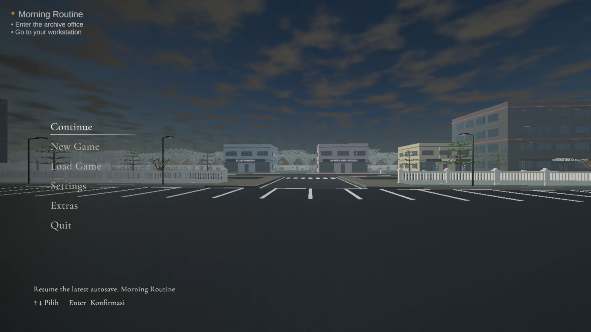
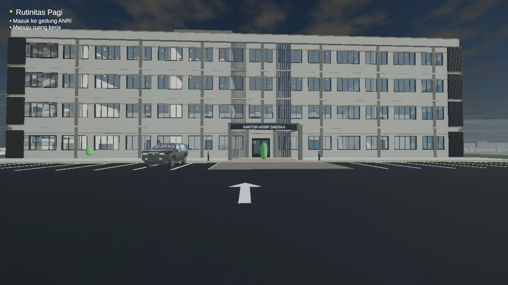
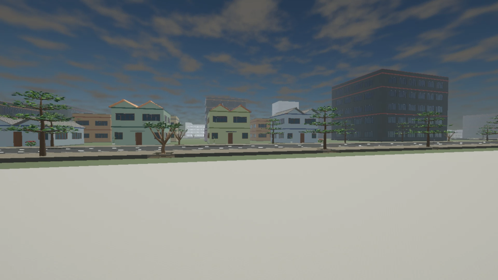
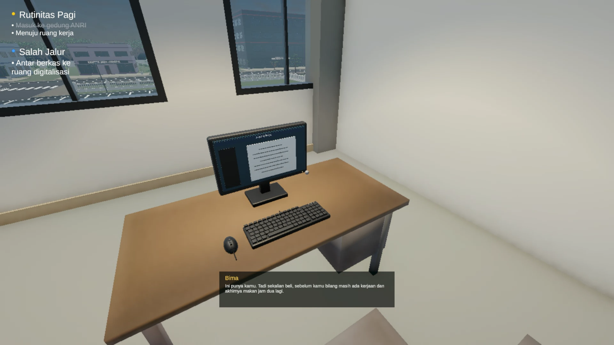
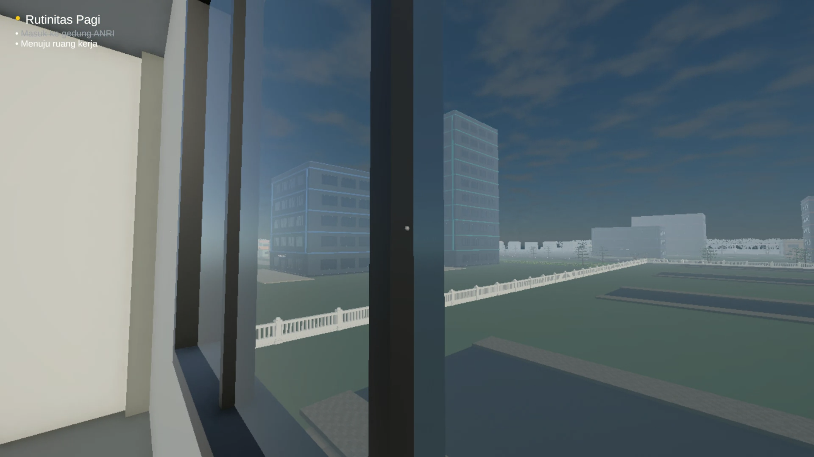
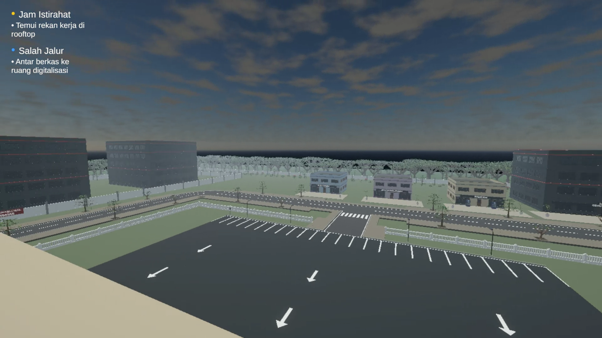
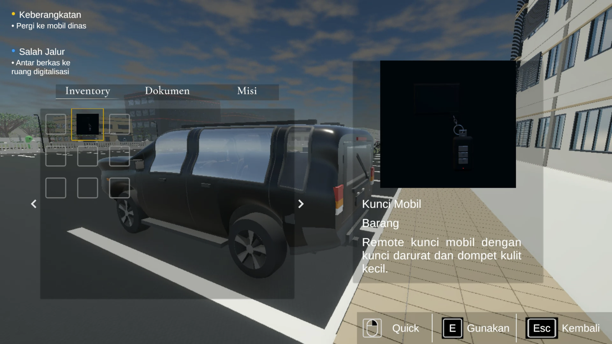
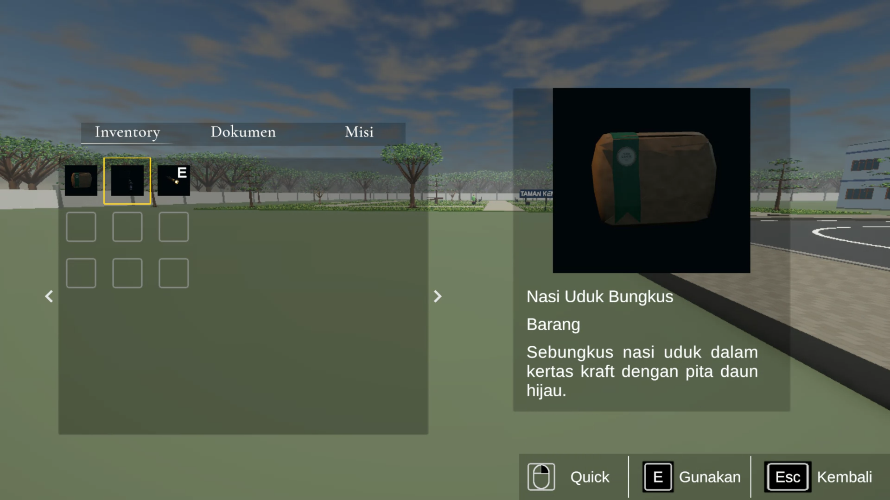
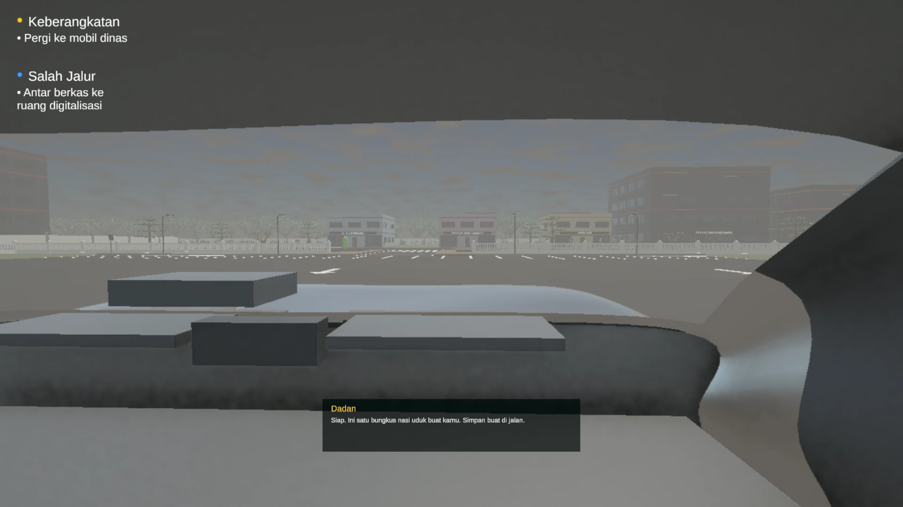
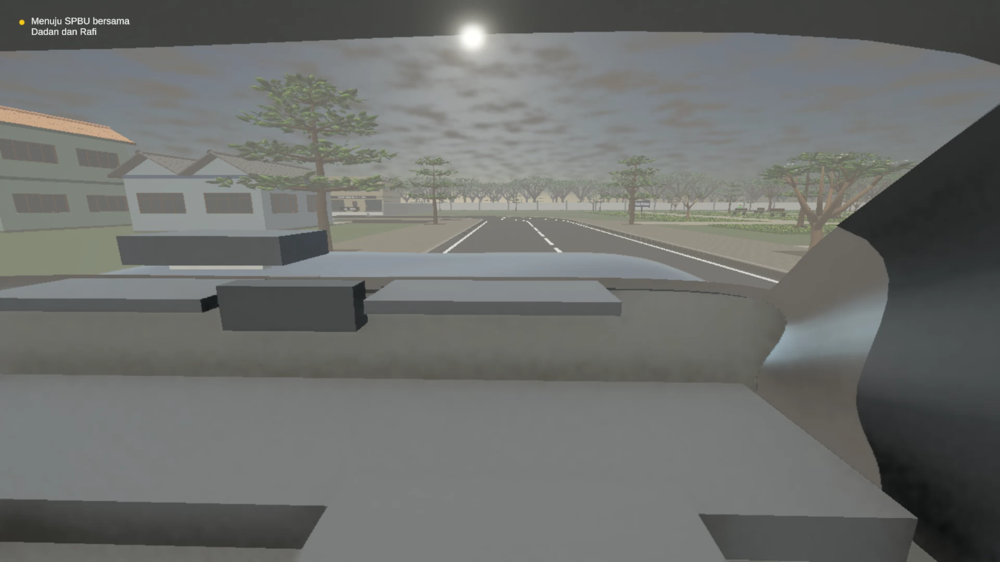

# The Last Witness (Saksi Terakhir)

[Bahasa Indonesia — Saksi Terakhir](README.md) · **English**

-000000?logo=unity)

A first-person 3D psychological horror and mystery game set in Indonesia. A regional archive officer and two colleagues investigate a remote village discovered in old records. Players explore the archive complex and surrounding district, follow contextual conversations, inspect original-script documents alongside their translations, and make decisions persisted as story conditions.

This repository contains the Unity project, runtime and Editor C# code, modular 3D assets, story definitions, automated tests, and Blender (`.blend`) sources. This documentation describes the architecture and currently implemented systems without spoiling the core mystery.

---

## Table of Contents

- [Screenshots Gallery](#screenshots-gallery)
- [Key Features](#key-features)
- [Development Status](#development-status)
- [Technology Stack](#technology-stack)
- [Opening the Project](#opening-the-project)
- [Controls](#controls)
- [Gameplay Systems](#gameplay-systems)
  - [Player, Camera, and Interaction](#player-camera-and-interaction)
  - [Inventory, Document Reader, and Held Items](#inventory-document-reader-and-held-items)
  - [Quests, Story Branching, and Dialogue](#quests-story-branching-and-dialogue)
  - [NPCs and World Population](#npcs-and-world-population)
  - [Doors, 5-Floor Elevator, and Vehicles](#doors-5-floor-elevator-and-vehicles)
  - [Audio, Settings, Time of Day, and Localization](#audio-settings-time-of-day-and-localization)
- [Save, Load, and Main Menu](#save-load-and-main-menu)
- [Project Structure and Scenes](#project-structure-and-scenes)
- [Editor Tools](#editor-tools)
- [Testing and Contribution Guidelines](#testing-and-contribution-guidelines)
- [Repository Hygiene and Documentation](#repository-hygiene-and-documentation)
- [License](#license)

---

## Screenshots Gallery

All screenshots are captured directly from the active [Regional Archive Office](Assets/_Project/Scenes/Regional%20Archive%20Office.unity) scene at 1080p and stored in [docs/screenshots](docs/screenshots).

### Regional Archive Office & Urban District

| Regional Archive Office Facade | Surrounding Urban District |
| :---: | :---: |
|  |  |
| *Four-story Regional Archive Office building with parking lot, service SUV, and active quest tracker.* | *Loop road network, sidewalks, shops, and surrounding buildings around the archive complex.* |

### Interior Exploration & Rooftop

| Workstation & Colleague Interaction | Corridor Window View |
| :---: | :---: |
|  |  |
| *Staff floor workstation with contextual dialogue and main (yellow) + optional (blue) quest tracker.* | *First-person view from inside the building overlooking the courtyard and surrounding district.* |

| Rooftop Break Area | Live World Preview Main Menu |
| :---: | :---: |
|  |  |
| *The archive office rooftop terrace where the opening Chapter 1 meeting takes place.* | *Main menu integrated directly with the live world camera and latest autosave status.* |

### 3D Inventory & Item Inspection

| Service Car Key in Inventory | Wrapped Nasi Uduk & Held Slot Indicator |
| :---: | :---: |
|  |  |
| *3×3 inventory grid with **Inventory**, **Documents**, and **Quests** tabs alongside 3D item preview.* | *Physical item inspection showing the active held-item badge (`E`).* |

### Departure & Vehicle Journey

| In-Car Dialogue Before Departure | Automatic Journey to the Fuel Station |
| :---: | :---: |
|  |  |
| *Branch-dependent conversation inside the vehicle cabin prior to departure.* | *Automated drive along the district road network with free passenger-seat camera look.* |

---

## Key Features

- **Condition-Driven Branching Narrative:** Player choices (breakfast, wrong-route errand, shared lunch, agenda writing, supply shopping, and fuel-station interactions) are deterministically recorded in [ChapterOneStoryState](Assets/_Project/Scripts/Runtime/Story/ChapterOneStoryState.cs), shaping dialogue branches, vehicle driver assignment, and carried items.
- **Grid Inventory, Bilingual Document Reader & Quest Item Protection:** Supports drag-and-drop, right-click context actions, up to two simultaneously held items, an in-panel document reader toggling original script and localized translation, and a pulsing border for active quest items.
- **Dynamic NPC Population & Corridor Right-of-Way:** Manages up to 15 simultaneously rendered NPCs with object pooling, work routines (seated work, typing, cleaning, carrying documents, patrolling), contextual greetings, and priority-based corridor yielding.
- **Interactive Environment & Automated Vehicles:** Passage-aware automatic doors, a 5-stop office elevator (Floors 1–4 and Rooftop) with auto-closing sliding doors, and an automated car journey to the fuel station.
- **Encrypted & Tamper-Evident Persistence:** Autosaves use an **AES-256-CBC** encrypted and **HMAC-SHA256** authenticated JSON envelope with atomic file replacement and `.bak` recovery.

---

## Development Status

The project is under active development. **Chapter 1** systems cover morning office routines, finding colleagues, boss briefings, departure preparations, an automated car journey to a fuel station, fuel-station exploration and dialogue, and a fade-to-black chapter ending.

- In the **Unity Editor**, the Chapter 1 ending stops Play Mode once progress is saved.
- In a **player build**, the ending freezes gameplay on a black screen; the transition to Chapter 2 (the village scene) is not connected yet.

The primary scene is [Regional Archive Office](Assets/_Project/Scenes/Regional%20Archive%20Office.unity), the only scene currently enabled in [EditorBuildSettings.asset](ProjectSettings/EditorBuildSettings.asset). The village scene ([Regional Vilage](Assets/_Project/Scenes/Regional%20Vilage.unity)) and assembly scenes under [TMP Scene](Assets/_Project/Scenes/TMP%20Scene) are included for ongoing development.

> [!NOTE]
> Package versions, file paths, and documentation references were verified against the repository on **November 23, 2026**.

---

## Technology Stack

| Component | Version / Usage |
| --- | --- |
| **Unity Editor** | **6000.3.24f1 — Unity 6.3 LTS** ([ProjectVersion.txt](ProjectSettings/ProjectVersion.txt)) |
| **Universal Render Pipeline (URP)** | **17.3.0** |
| **Input System** | **1.19.0** |
| **AI Navigation** | **2.0.11** |
| **uGUI & TextMeshPro** | **2.0.0** |
| **Timeline** | **1.8.11** |
| **Unity Test Framework** | **1.6.0** (EditMode & PlayMode suites) |
| **Unity Recorder** | **5.1.8** |
| **Programming Language** | C# with separate Runtime, Editor, and Test assemblies |
| **Localization** | Custom Indonesian & English localization table |
| **Persistence** | Encrypted & authenticated JSON snapshots (`AES-256-CBC` + `HMAC-SHA256`) |
| **Asset Pipeline** | Blender (`.blend`), FBX models, URP materials, textures, and modular prefabs |

---

## Opening the Project

1. Install **Unity Hub** and Unity Editor **6000.3.24f1**.
2. Add the repository folder in Unity Hub and open the project.
3. Wait for package resolution, asset import, and script compilation to complete (`Library/` is generated automatically).
4. Open [Assets/_Project/Scenes/Regional Archive Office.unity](Assets/_Project/Scenes/Regional%20Archive%20Office.unity).
5. Enter **Play Mode**. Select **New Game** (*Permainan Baru*) to start fresh, or **Continue** (*Lanjutkan*) if a valid autosave exists.

---

## Controls

Bindings are configured in [InputSystem_Actions.inputactions](Assets/InputSystem_Actions.inputactions) and read by [PlayerInputReader](Assets/_Project/Scripts/Runtime/Player/PlayerInputReader.cs).

| Action | Keyboard & Mouse | Gamepad |
| --- | --- | --- |
| **Move** | `W` `A` `S` `D` or Arrow Keys | Left Stick |
| **Look** | Mouse Movement | Right Stick |
| **Sprint** | `Left Shift` (Hold or Toggle in Settings) | Left Stick Press (`L3`) |
| **Crouch** | `C` | `B` / Circle |
| **Jump** | `Space` | `A` / Cross |
| **Interact** | `E` | `Y` / Triangle |
| **Open / Close Inventory & Journal** | `Tab` | `Select` / `View` |
| **Close Panel / Request Pause** | `Escape` | `Start` / `Menu` |
| **Select Item / Quest** | Left Click | — |
| **Item Context Menu** | Right Click | — |
| **Move / Drop Item** | Drag and Drop | — |

---

## Gameplay Systems

### Player, Camera, and Interaction

- **[PlayerController](Assets/_Project/Scripts/Runtime/Player/PlayerController.cs):** Handles walking, sprinting, crouching with ceiling clearance checks, jumping, gravity, and movement locks during UI, dialogue, or cinematic sequences.
- **[PlayerCameraController](Assets/_Project/Scripts/Runtime/Player/PlayerCameraController.cs):** Controls pitch/yaw look, sensitivity, FOV, seated yaw limits, dialogue speaker focus, and main-menu camera sway.
- **[PlayerInteractor](Assets/_Project/Scripts/Runtime/Interaction/PlayerInteractor.cs) & [InteractionPromptView](Assets/_Project/Scripts/Runtime/Interaction/InteractionPromptView.cs):** Performs raycast detection against the `Interactable` layer and renders localized interaction prompts and ambient NPC subtitles.

### Inventory, Document Reader, and Held Items

| Feature | Implementation |
| --- | --- |
| **Item Grid** | Defaults to **3 × 3**; configurable from **1–8 columns** and **1–8 rows** (up to **64 slots**). |
| **Documents Tab** | Stored separately from physical grid slots and paired with [InventoryDocumentView](Assets/_Project/Scripts/Runtime/Inventory/InventoryDocumentView.cs) to toggle original script and translated text. |
| **Drag & Drop** | Rearranges or swaps slots; dragging an item outside the panel spawns a physical 3D pickup in the world ([InventoryWorldItemFactory](Assets/_Project/Scripts/Runtime/Inventory/InventoryWorldItemFactory.cs)). |
| **World Pickups** | Dropped items receive a collider and `Rigidbody` and preserve their `InstanceId` when picked back up ([ItemPickupInteractable](Assets/_Project/Scripts/Runtime/Inventory/ItemPickupInteractable.cs)). |
| **Held Items** | Up to **2 items** can be held simultaneously; holding a third replaces the oldest held item ([InventoryHeldItemView](Assets/_Project/Scripts/Runtime/Inventory/InventoryHeldItemView.cs)). |
| **Quest Item Protection** | [InventoryQuestProtection](Assets/_Project/Scripts/Runtime/Inventory/InventoryQuestProtection.cs) and [InventoryQuestFrame](Assets/_Project/Scripts/Runtime/Inventory/InventoryQuestFrame.cs) highlight required quest items and prevent discarding them while needed. |

### Quests, Story Branching, and Dialogue

- **[ChapterOneDirector](Assets/_Project/Scripts/Runtime/Story/ChapterOneDirector.cs) & [ChapterOneProgress](Assets/_Project/Scripts/Runtime/Story/ChapterOneProgress.cs):** Drive Chapter 1 progression from the morning routine and rooftop meeting through colleague search, final briefing, key pickup, and departure.
- **[QuestJournalController](Assets/_Project/Scripts/Runtime/Story/QuestJournalController.cs) & [QuestTrackerView](Assets/_Project/Scripts/Runtime/Story/QuestTrackerView.cs):** Support **Main** (yellow), **Side** (green), and **Optional** (blue) quests, allowing one supporting quest to be tracked below the main quest.

### NPCs and World Population

- **[NpcPopulationManager](Assets/_Project/Scripts/Runtime/Npc/NpcPopulationManager.cs) & [OfficeNpcDirector](Assets/_Project/Scripts/Runtime/Npc/OfficeNpcDirector.cs):** Manage pooling, distance-based spawning, and a **15-rendered-NPC budget** while protecting active mission participants.
- **[NpcPassageYield](Assets/_Project/Scripts/Runtime/Npc/NpcPassageYield.cs) & [NpcTrafficDecision](Assets/_Project/Scripts/Runtime/Npc/NpcTrafficDecision.cs):** Resolve corridor and doorway encounters using `0–10` traffic priorities.

### Doors, 5-Floor Elevator, and Vehicles

- **[DoorInteractable](Assets/_Project/Scripts/Runtime/Interaction/DoorInteractable.cs) & [ItemKeyLock](Assets/_Project/Scripts/Runtime/Inventory/ItemKeyLock.cs):** Support swing, sliding, and roll-up doors, key-item locks, and occupancy-aware auto-close timers.
- **[OfficeElevator](Assets/_Project/Scripts/Runtime/Environment/OfficeElevator.cs) & [ElevatorButton](Assets/_Project/Scripts/Runtime/Environment/ElevatorButton.cs):** Operate the 5-stop office elevator (Floors 1–4 and Rooftop) via exterior call buttons and interior cabin floor buttons, with a 5-second auto-close countdown once doors open completely.
- **[VehicleKeyUse](Assets/_Project/Scripts/Runtime/VehicleKeyUse.cs), [VehicleJourneyDirector](Assets/_Project/Scripts/Runtime/VehicleJourneyDirector.cs) & [AutomaticVehicleDriver](Assets/_Project/Scripts/Runtime/AutomaticVehicleDriver.cs):** Handle remote unlocking, branch-dependent seating, and automated driving along [VehicleRoutePath](Assets/_Project/Scripts/Runtime/VehicleRoutePath.cs) to the fuel station.
- **[FuelStationChapterDirector](Assets/_Project/Scripts/Runtime/Story/FuelStationChapterDirector.cs):** Coordinates timed fuel-station exploration, conversations, photo/document collection, and the Chapter 1 ending.

### Audio, Settings, Time of Day, and Localization

- **[AudioManager](Assets/_Project/Scripts/Runtime/Audio/AudioManager.cs) & [OfficeBgmController](Assets/_Project/Scripts/Runtime/Audio/OfficeBgmController.cs):** Manage background music with smooth crossfading between the main menu and office gameplay tracks.
- **[GameSettingsManager](Assets/_Project/Scripts/Runtime/Settings/GameSettingsManager.cs) & [SettingsMenuPresentation](Assets/_Project/Scripts/Runtime/UI/SettingsMenuPresentation.cs):** Provide an 8-tab settings menu (Controls, Camera, Gameplay, Display, Graphics, Audio, Language, Accessibility).
- **[TimeOfDayApplier](Assets/_Project/Scripts/Runtime/Environment/TimeOfDayApplier.cs) & [TimeOfDayPreset](Assets/_Project/Scripts/Runtime/Environment/TimeOfDayPreset.cs):** Apply 7 lighting presets (`05:00`, `07:00`, `11:00`, `13:00`, `17:00`, `20:00`, `00:00`) stored in [Assets/_Project/Environment](Assets/_Project/Environment).
- **[LocalizationManager](Assets/_Project/Scripts/Runtime/Localization/LocalizationManager.cs) & [LocalizationTable.asset](Assets/_Project/Localization/LocalizationTable.asset):** Store 580+ Indonesian and English text entries with live UI refresh.

---

## Save, Load, and Main Menu

[GameSessionController](Assets/_Project/Scripts/Runtime/Persistence/GameSessionController.cs) coordinates session lifecycle and [MainMenuPresentation](Assets/_Project/Scripts/Runtime/UI/MainMenuPresentation.cs). Autosaves are written to `Application.persistentDataPath/autosave.json` (with `.bak` backup recovery via [GameSaveRepository](Assets/_Project/Scripts/Runtime/Persistence/GameSaveRepository.cs)) and protected with **AES-256-CBC** encryption and **HMAC-SHA256** authentication in [ProtectedJsonSaveStore](Assets/_Project/Scripts/Runtime/Persistence/ProtectedJsonSaveStore.cs).

---

## Project Structure and Scenes

| Directory | Contents |
| --- | --- |
| [Assets/_Project/Scripts/Runtime](Assets/_Project/Scripts/Runtime) | Runtime gameplay systems (`Audio`, `Environment`, `Interaction`, `Inventory`, `Localization`, `Navigation`, `Npc`, `Persistence`, `Player`, `Settings`, `Story`, `UI`, vehicles) |
| [Assets/_Project/Scripts/Editor](Assets/_Project/Scripts/Editor) | Editor setup, asset generation, and verification tools |
| [Assets/_Project/Tests](Assets/_Project/Tests) | **EditMode** and **PlayMode** automated test suites |
| [Assets/_Project/Scenes](Assets/_Project/Scenes) | Main gameplay scene, village scene, and assembly scenes under `TMP Scene/` |
| [Assets/_Project/Prefabs](Assets/_Project/Prefabs) | Player, NPC, vehicle, pickup, and modular office/elevator prefabs |
| [Assets/_Project/Items](Assets/_Project/Items) | `ItemDefinition` assets and icon sprites |
| [Assets/_Project/Story](Assets/_Project/Story) | `QuestDefinition` and `DialogueSequence` assets |
| [Assets/_Project/Localization](Assets/_Project/Localization) | `LocalizationTable.asset` |
| [Assets/ModularAsset](Assets/ModularAsset) | Modular `Bangunan`, `Lingkungan`, and `Perlengkapan` kits |
| [SourceArt](SourceArt) | Blender (`.blend`) source files |
| [docs/screenshots](docs/screenshots) | Tracked gameplay screenshots used in the READMEs |

| Scene | Path & Purpose |
| --- | --- |
| **Regional Archive Office** | [Assets/_Project/Scenes/Regional Archive Office.unity](Assets/_Project/Scenes/Regional%20Archive%20Office.unity) — Main office district and Chapter 1 gameplay scene (enabled in Build Settings). |
| **Regional Vilage** | [Assets/_Project/Scenes/Regional Vilage.unity](Assets/_Project/Scenes/Regional%20Vilage.unity) — Village scene for future chapters. |
| **OfficeArchive_Assembly** | [Assets/_Project/Scenes/TMP Scene/OfficeArchive_Assembly.unity](Assets/_Project/Scenes/TMP%20Scene/OfficeArchive_Assembly.unity) — Modular office assembly workspace. |
| **WarehouseArchive_Assembly** | [Assets/_Project/Scenes/TMP Scene/WarehouseArchive_Assembly.unity](Assets/_Project/Scenes/TMP%20Scene/WarehouseArchive_Assembly.unity) — Archive warehouse assembly workspace. |
| **RoadLoop_Assembly** | [Assets/_Project/Scenes/TMP Scene/RoadLoop_Assembly.unity](Assets/_Project/Scenes/TMP%20Scene/RoadLoop_Assembly.unity) — District road network assembly workspace. |
| **ItemShow** | [Assets/_Project/Scenes/TMP Scene/ItemShow.unity](Assets/_Project/Scenes/TMP%20Scene/ItemShow.unity) — 3D photo studio for rendering inventory item icons. |

---

## Editor Tools

The `Saksi Terakhir` menu in the Unity Editor provides setup utilities (save your scene before running scene-modifying tools):

| `Saksi Terakhir` Menu | Script / Purpose |
| --- | --- |
| `Chapter One/Configure Active World` | [ChapterOneWorldSetup](Assets/_Project/Scripts/Editor/ChapterOneWorldSetup.cs) — Wires Chapter 1 content in the active world |
| `Inventory/Hubungkan UI Inventory` | [InventorySceneSetup](Assets/_Project/Scripts/Editor/InventorySceneSetup.cs) — Connects inventory UI references |
| `Inventory/Buat Catalog dan Prefab Pickup` | [InventoryItemAssetSetup](Assets/_Project/Scripts/Editor/InventoryItemAssetSetup.cs) — Builds item catalog and pickup prefabs |
| `NPC/Set Up World Population` | [WorldNpcSceneSetup](Assets/_Project/Scripts/Editor/WorldNpcSceneSetup.cs) — Configures world NPC spawn points and population |
| `Doors/Configure Active Scene` | [WorldDoorSetup](Assets/_Project/Scripts/Editor/WorldDoorSetup.cs) — Configures door interactables in the active scene |
| `Vehicles/Connect Office To SPBU Journey` | [VehicleJourneySetup](Assets/_Project/Scripts/Editor/VehicleJourneySetup.cs) — Wires the office-to-fuel-station vehicle route |
| `Connect Fuel Station Chapter Ending` | [FuelStationChapterSetup](Assets/_Project/Scripts/Editor/FuelStationChapterSetup.cs) — Connects fuel-station activities and ending |
| `Time Of Day/Configure Active Scene` | [TimeOfDaySetup](Assets/_Project/Scripts/Editor/TimeOfDaySetup.cs) — Creates and binds time-of-day presets |
| `Audio/Setup Office Audio` | [OfficeAudioSetup](Assets/_Project/Scripts/Editor/OfficeAudioSetup.cs) — Configures menu and office BGM clips |
| `Create Localization Table` | [LocalizationTableSetup](Assets/_Project/Scripts/Editor/LocalizationTableSetup.cs) — Creates/updates `LocalizationTable.asset` |
| `ItemShow/Buat Ulang Studio Foto` | [ItemShowPhotoStudioSetup](Assets/_Project/Scripts/Editor/ItemShowPhotoStudioSetup.cs) — Rebuilds the item icon photo studio |

---

## Testing and Contribution Guidelines

Run **EditMode** ([Assets/_Project/Tests/Editor](Assets/_Project/Tests/Editor)) and **PlayMode** ([Assets/_Project/Tests/PlayMode](Assets/_Project/Tests/PlayMode)) suites via **Window > General > Test Runner**. Preserve item/quest IDs, localization keys, save schema compatibility, and asset GUIDs when modifying code.

---

## Repository Hygiene and Documentation

- [.gitignore](.gitignore) excludes Unity generated folders (`Library/`, `Temp/`, `Logs/`, `UserSettings/`, `Build/`, `Builds/`, `Recordings/`), IDE files, crash dumps, Python caches, Blender backups, and local story manuscripts (`/docs/bab-*.md`).
- [docs/screenshots](docs/screenshots) is explicitly unignored (`!/docs/screenshots/**`) so README screenshots are tracked by Git without being imported as Unity runtime textures inside `Assets/`.

---

## License

This project is licensed under the **GNU General Public License v3.0 (GPL-3.0)** — see the [LICENSE](LICENSE) file at the repository root for the full terms. Third-party font licenses remain in [Assets/_Project/UI/Fonts/Licenses](Assets/_Project/UI/Fonts/Licenses).
